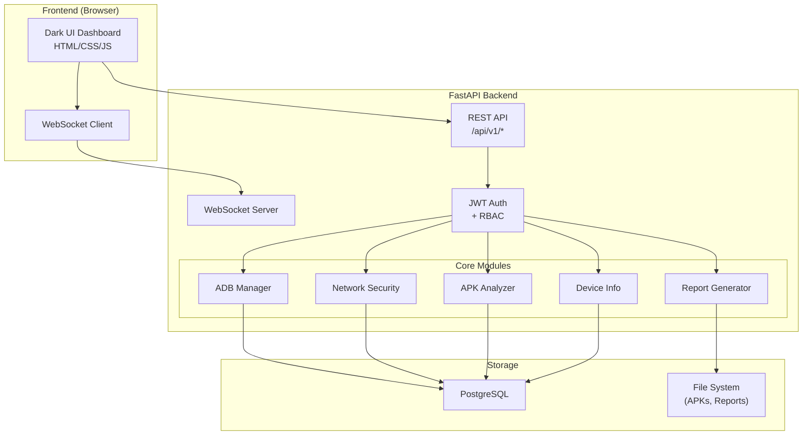

# Android Security Assessment Toolkit (ASAT)

A professional-grade Android Security Assessment Toolkit for educational purposes and authorized penetration testing. Python 3.12 + FastAPI backend with a premium dark-themed web dashboard, PostgreSQL database, and integrated ADB automation.

## User Review Required

> [!IMPORTANT]
> **PostgreSQL**: The plan uses PostgreSQL via Docker. If Docker is not installed, I'll fall back to SQLite with an option to switch to PostgreSQL later. Please confirm if Docker is available.

> [!IMPORTANT]
> **ADB**: ADB was not found in PATH. The toolkit will still build and run, but ADB-related features will show "ADB not configured" until you install Android SDK Platform Tools and add them to your PATH.

> [!NOTE]
> **Scope**: This build covers the **Python FastAPI backend** + **pure HTML/CSS/JS web dashboard** served by FastAPI. The Android Kotlin companion app is deferred to a future phase.

## Open Questions

1. **Authentication**: Should the toolkit support multi-user login from the start (JWT + roles), or is single-user mode acceptable for v1?
2. **APK Upload Size**: What's the maximum APK size you want to support for analysis? Default will be 500MB.
3. **Port**: Any preferred port for the FastAPI server? Default will be `8000`.

---

## Architecture Overview



---

## Project Structure

```
android-security-toolkit/
├── backend/
│   ├── app/
│   │   ├── __init__.py
│   │   ├── main.py                    # FastAPI app entry point
│   │   ├── config.py                  # Settings & environment config
│   │   ├── database.py                # DB connection & session
│   │   │
│   │   ├── models/                    # SQLAlchemy ORM models
│   │   │   ├── __init__.py
│   │   │   ├── user.py
│   │   │   ├── device.py
│   │   │   ├── scan_result.py
│   │   │   ├── audit_log.py
│   │   │   └── report.py
│   │   │
│   │   ├── schemas/                   # Pydantic schemas
│   │   │   ├── __init__.py
│   │   │   ├── user.py
│   │   │   ├── device.py
│   │   │   ├── scan.py
│   │   │   └── report.py
│   │   │
│   │   ├── api/                       # API route handlers
│   │   │   ├── __init__.py
│   │   │   ├── auth.py                # Login, register, JWT
│   │   │   ├── devices.py             # Device management
│   │   │   ├── adb.py                 # ADB automation endpoints
│   │   │   ├── scanner.py             # Network security scans
│   │   │   ├── apk.py                 # APK analysis endpoints
│   │   │   ├── reports.py             # Report generation
│   │   │   └── websocket.py           # WebSocket handlers
│   │   │
│   │   ├── core/                      # Business logic
│   │   │   ├── __init__.py
│   │   │   ├── security.py            # JWT, hashing, auth utils
│   │   │   ├── adb_manager.py         # ADB command execution
│   │   │   ├── apk_analyzer.py        # AndroidManifest parsing, permission analysis
│   │   │   ├── network_scanner.py     # Port scan, DNS, SSL, WHOIS, ping
│   │   │   ├── device_auditor.py      # Security audit logic
│   │   │   ├── report_generator.py    # PDF, HTML, CSV generation
│   │   │   └── risk_scorer.py         # Risk scoring engine
│   │   │
│   │   ├── middleware/                 # Custom middleware
│   │   │   ├── __init__.py
│   │   │   ├── audit.py               # Audit logging middleware
│   │   │   └── rate_limit.py          # Rate limiting
│   │   │
│   │   └── utils/                     # Helpers
│   │       ├── __init__.py
│   │       ├── adb_commands.py        # ADB command builder
│   │       └── validators.py          # Input validation
│   │
│   ├── tests/                         # Unit tests
│   │   ├── __init__.py
│   │   ├── test_auth.py
│   │   ├── test_adb.py
│   │   ├── test_scanner.py
│   │   ├── test_apk.py
│   │   └── test_reports.py
│   │
│   ├── alembic/                       # DB migrations
│   │   ├── env.py
│   │   └── versions/
│   │
│   ├── requirements.txt
│   ├── alembic.ini
│   └── Dockerfile
│
├── frontend/
│   ├── index.html                     # Main SPA entry
│   ├── css/
│   │   ├── main.css                   # Design system + theme
│   │   ├── components.css             # Reusable component styles
│   │   └── dashboard.css              # Dashboard-specific styles
│   ├── js/
│   │   ├── app.js                     # SPA router & init
│   │   ├── api.js                     # API client + interceptors
│   │   ├── auth.js                    # JWT storage & refresh
│   │   ├── websocket.js               # WebSocket client
│   │   ├── components/
│   │   │   ├── sidebar.js
│   │   │   ├── header.js
│   │   │   ├── device-card.js
│   │   │   ├── log-viewer.js
│   │   │   ├── chart.js
│   │   │   └── modal.js
│   │   └── pages/
│   │       ├── login.js
│   │       ├── dashboard.js
│   │       ├── devices.js
│   │       ├── adb.js
│   │       ├── scanner.js
│   │       ├── apk-analysis.js
│   │       ├── reports.js
│   │       └── settings.js
│   └── assets/
│       ├── icons/                     # SVG icons
│       └── fonts/
│
├── docker-compose.yml                 # PostgreSQL + app
├── .env.example
├── README.md
└── LICENSE
```

---

## Proposed Changes

### Phase 1: Foundation & Backend Core

#### [NEW] `docker-compose.yml`
- PostgreSQL 16 container with persistent volume
- Environment variable configuration
- Health check for database readiness

#### [NEW] `.env.example`
- All configurable environment variables (DB URL, JWT secret, ADB path, etc.)

#### [NEW] `backend/requirements.txt`
- FastAPI, uvicorn, SQLAlchemy, asyncpg, alembic, python-jose (JWT), passlib, python-multipart, websockets, aiofiles, jinja2, reportlab (PDF), whois, dnspython, httpx

#### [NEW] `backend/app/main.py`
- FastAPI application factory
- CORS middleware
- Static file serving for frontend
- Router registration
- Startup/shutdown events (DB pool, ADB check)
- WebSocket manager initialization

#### [NEW] `backend/app/config.py`
- Pydantic Settings class reading from `.env`
- Database URL, JWT settings, ADB path, upload limits

#### [NEW] `backend/app/database.py`
- Async SQLAlchemy engine + session factory
- Base model class
- `get_db` dependency

---

### Phase 2: Data Models & Authentication

#### [NEW] `backend/app/models/*.py`
- **User**: id, username, email, hashed_password, role (admin/analyst/viewer), created_at, is_active
- **Device**: id, serial, model, android_version, patch_level, status, last_seen, metadata (JSON)
- **ScanResult**: id, device_id, scan_type, findings (JSON), risk_score, created_at
- **AuditLog**: id, user_id, action, resource, details, ip_address, timestamp
- **Report**: id, title, type (pdf/html/csv), file_path, created_by, created_at

#### [NEW] `backend/app/schemas/*.py`
- Pydantic request/response models with full type hints and validation

#### [NEW] `backend/app/core/security.py`
- Password hashing (bcrypt)
- JWT token creation/verification (access + refresh tokens)
- Role-based permission decorators
- Current user dependency

#### [NEW] `backend/app/api/auth.py`
- `POST /api/v1/auth/register` — Create account
- `POST /api/v1/auth/login` — Returns JWT pair
- `POST /api/v1/auth/refresh` — Refresh access token
- `GET /api/v1/auth/me` — Current user info

---

### Phase 3: ADB Automation Module

#### [NEW] `backend/app/core/adb_manager.py`
- Async ADB command executor (subprocess wrapper with timeout)
- Device discovery (`adb devices`)
- Device info collection (getprop, dumpsys)
- Package management (list, install, uninstall)
- Logcat streaming (async generator)
- Screenshot capture (`adb exec-out screencap`)
- Screen recording (`adb shell screenrecord`)
- File push/pull
- Safety: command whitelist to prevent injection

#### [NEW] `backend/app/utils/adb_commands.py`
- Command builder pattern for constructing safe ADB commands
- Parameter sanitization

#### [NEW] `backend/app/api/adb.py`
- `GET /api/v1/adb/devices` — List connected devices
- `GET /api/v1/adb/device/{serial}/info` — Device properties
- `GET /api/v1/adb/device/{serial}/packages` — Installed packages
- `POST /api/v1/adb/device/{serial}/install` — Install APK
- `DELETE /api/v1/adb/device/{serial}/package/{name}` — Uninstall
- `GET /api/v1/adb/device/{serial}/screenshot` — Capture screenshot
- `POST /api/v1/adb/device/{serial}/screenrecord` — Start recording
- `GET /api/v1/adb/device/{serial}/logcat` — Stream via WebSocket
- `POST /api/v1/adb/device/{serial}/push` — Push file
- `GET /api/v1/adb/device/{serial}/pull` — Pull file

---

### Phase 4: Security Analysis Modules

#### [NEW] `backend/app/core/apk_analyzer.py`
- Parse AndroidManifest.xml (using `aapt` or pure Python XML parsing on decompiled manifests)
- Dangerous permission detection and classification
- Exported component analysis (activities, services, receivers, providers)
- Backup configuration check (`android:allowBackup`)
- Debuggable flag check
- Network security config analysis
- Min/target SDK analysis
- Risk scoring per finding

#### [NEW] `backend/app/core/network_scanner.py`
- **Port scanner**: Async TCP connect scan on common ports (with configurable port ranges)
- **DNS lookup**: A, AAAA, MX, NS, TXT records using `dnspython`
- **HTTP header analysis**: Security headers check (HSTS, CSP, X-Frame-Options, etc.)
- **SSL certificate inspector**: Certificate chain, expiry, cipher suites using `ssl` module
- **WHOIS lookup**: Domain registration info using `python-whois`
- **Ping**: ICMP ping via subprocess
- **Traceroute**: Via subprocess

#### [NEW] `backend/app/core/device_auditor.py`
- Aggregates device info + APK analysis + network checks
- Checks: root detection, developer options, USB debugging, encryption status, screen lock
- Produces consolidated security posture report

#### [NEW] `backend/app/core/risk_scorer.py`
- Weighted scoring algorithm
- Categories: Critical (10), High (8), Medium (5), Low (2), Info (1)
- Overall device risk score (0-100)
- Per-finding severity classification

---

### Phase 5: Reporting Engine

#### [NEW] `backend/app/core/report_generator.py`
- **PDF**: Using ReportLab — branded header, risk summary, findings table, recommendations
- **HTML**: Jinja2 template — interactive, self-contained HTML report with embedded CSS
- **CSV**: Findings export with columns (category, severity, finding, recommendation)
- Security recommendations engine (maps findings → actionable advice)

#### [NEW] `backend/app/api/reports.py`
- `POST /api/v1/reports/generate` — Generate report (pdf/html/csv)
- `GET /api/v1/reports/` — List reports
- `GET /api/v1/reports/{id}/download` — Download report file
- `DELETE /api/v1/reports/{id}` — Delete report

---

### Phase 6: WebSocket & Real-time

#### [NEW] `backend/app/api/websocket.py`
- Connection manager (connect, disconnect, broadcast)
- Logcat live streaming channel
- Scan progress updates
- Device status changes
- ADB event notifications

---

### Phase 7: Middleware & Audit

#### [NEW] `backend/app/middleware/audit.py`
- Logs every API request: user, endpoint, method, IP, timestamp, response status
- Stores in AuditLog table

#### [NEW] `backend/app/middleware/rate_limit.py`
- Token bucket rate limiter per IP/user
- Configurable limits per endpoint group

---

### Phase 8: Web Dashboard (Frontend)

#### [NEW] `frontend/css/main.css`
- **Design system**: CSS custom properties for the entire theme
- **Color palette**: Deep navy/charcoal base, electric blue/cyan accents, red/amber for severity indicators
- **Typography**: Inter font family, fluid type scale
- **Dark mode**: Default dark theme with subtle glassmorphism panels
- **Animations**: Smooth transitions, skeleton loaders, pulse effects

#### [NEW] `frontend/css/components.css`
- Cards with glass effect and subtle borders
- Buttons (primary, secondary, danger, ghost) with hover micro-animations
- Form inputs with glow focus states
- Tables with alternating rows and sort indicators
- Badges (severity levels with color coding)
- Toast notifications
- Modal dialogs
- Sidebar navigation with active state indicators
- Progress bars and spinners
- Dropdown menus
- Tabs

#### [NEW] `frontend/css/dashboard.css`
- Grid layout for dashboard cards
- Chart containers
- Log viewer panel (monospace, scrollable, color-coded by level)
- Device detail panels
- Responsive breakpoints

#### [NEW] `frontend/index.html`
- Single Page Application shell
- Sidebar navigation
- Header with user menu
- Main content area (page router target)
- Toast container
- Modal container
- Links to CSS and JS

#### [NEW] `frontend/js/app.js`
- Hash-based SPA router
- Page initialization and teardown
- Global state management
- Theme management

#### [NEW] `frontend/js/api.js`
- Fetch wrapper with JWT interceptor
- Automatic token refresh on 401
- Error handling and toast notifications
- File upload/download helpers

#### [NEW] `frontend/js/auth.js`
- JWT token storage (localStorage)
- Login/logout flow
- Auth state management
- Route guards

#### [NEW] `frontend/js/websocket.js`
- Auto-reconnecting WebSocket client
- Message type routing
- Event emitter pattern

#### [NEW] Dashboard Pages (`frontend/js/pages/*.js`)

| Page | Features |
|------|----------|
| **Login** | Animated login form, registration option |
| **Dashboard** | Overview cards (devices, scans, risk), recent activity, charts |
| **Devices** | Device list/grid, device detail panel, ADB actions |
| **ADB** | Terminal-like logcat viewer, package manager, file transfer |
| **Scanner** | Port scan, DNS, SSL, HTTP headers — with live progress |
| **APK Analysis** | Upload APK, view manifest, permissions, exported components |
| **Reports** | Generate/download/delete reports, preview HTML reports |
| **Settings** | User profile, ADB path config, API tokens |

#### [NEW] Dashboard Components (`frontend/js/components/*.js`)

| Component | Features |
|-----------|----------|
| **Sidebar** | Collapsible nav, active indicators, badge counts |
| **Header** | User avatar, notifications bell, search |
| **Device Card** | Status indicator, key stats, quick actions |
| **Log Viewer** | Scrolling log, auto-scroll, level filtering, search |
| **Chart** | Canvas-based charts (bar, line, donut) using Chart.js CDN |
| **Modal** | Animated modal with form support |

---

### Phase 9: Docker & Documentation

#### [NEW] `backend/Dockerfile`
- Python 3.12-slim base
- Multi-stage build
- Non-root user

#### [NEW] `docker-compose.yml`
- PostgreSQL 16 service with health check
- Backend service with dependency on DB
- Volume mounts for uploads and reports

#### [NEW] `README.md`
- Project overview, features, screenshots
- Quick start guide
- API documentation links
- Security disclaimer and usage terms
- Architecture diagram

#### [NEW] `LICENSE`
- MIT License

---

### Phase 10: Tests

#### [NEW] `backend/tests/test_auth.py`
- Registration, login, token refresh, role checks

#### [NEW] `backend/tests/test_scanner.py`
- Port scan, DNS lookup, SSL check tests (with mocked sockets)

#### [NEW] `backend/tests/test_apk.py`
- Manifest parsing, permission analysis, risk scoring

#### [NEW] `backend/tests/test_adb.py`
- Command builder, device listing (mocked subprocess)

#### [NEW] `backend/tests/test_reports.py`
- PDF, HTML, CSV generation

---

## Verification Plan

### Automated Tests
```bash
cd backend
python -m pytest tests/ -v --tb=short
```

### Manual Verification
1. **Start services**: `docker-compose up -d` (PostgreSQL) + `uvicorn app.main:app --reload`
2. **Dashboard**: Open `http://localhost:8000` — verify dark UI loads, login works
3. **API docs**: Open `http://localhost:8000/docs` — verify Swagger UI
4. **ADB**: Connect an Android device/emulator, verify device discovery
5. **Scanner**: Run a port scan against `scanme.nmap.org` (public test target)
6. **APK upload**: Upload a sample APK and verify manifest analysis
7. **Reports**: Generate PDF/HTML/CSV and verify downloads
8. **WebSocket**: Verify real-time logcat streaming in the dashboard

---

## Implementation Order

| Step | Component | Estimated Files |
|------|-----------|----------------|
| 1 | Project setup, config, database, Docker | ~8 files |
| 2 | Models, schemas, auth | ~12 files |
| 3 | ADB manager + API routes | ~4 files |
| 4 | Network scanner + APK analyzer + device auditor | ~6 files |
| 5 | Report generator | ~3 files |
| 6 | WebSocket + middleware | ~4 files |
| 7 | Frontend CSS design system | ~3 files |
| 8 | Frontend JS core (router, API, auth, WS) | ~4 files |
| 9 | Frontend pages + components | ~14 files |
| 10 | Tests + Docker + README | ~8 files |
| **Total** | | **~66 files** |
